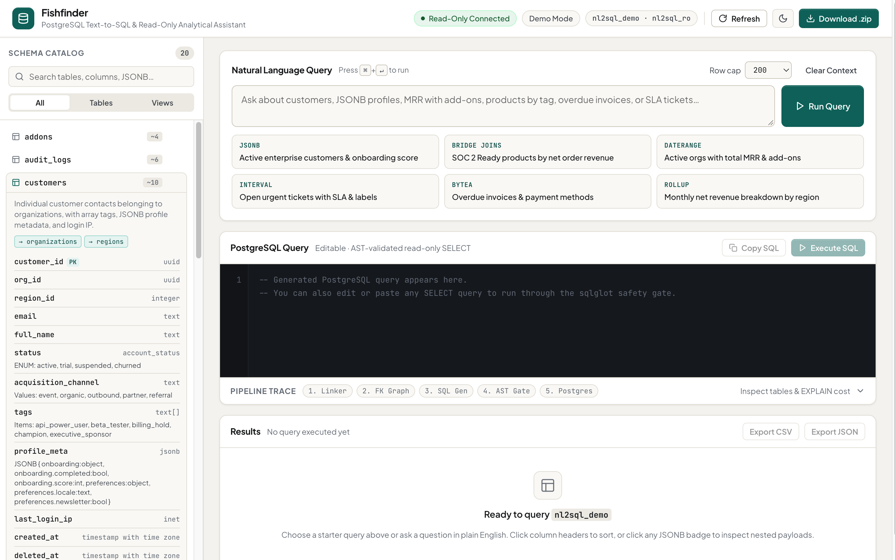

# fishfinder

_Under construction - generic proof of concept_

Prototyped at Snakecase 2026 event organized by Posit, Marimo, and pyOpenSci.
NOAA Fisheries is working on centralizing acoustic data into Postgres databases
for researchers to more easily access annotated data.

This repo provides a proof of concept that:
- a complex Postgres database can be searched using a natural language prompt
- a SQL query can be generated from the prompt for later reproducibility
- results can be displayed within the application

The proof of concept was created using Antigravity prompting and modified
by the author to customize the repo structure and apply Scientific Python
best practices.



## Proof of Concept

A production-minded PostgreSQL Text-to-SQL application implementing the
architecture in [`architecture_plan.md`](../artifacts/architecture_plan.md):
**Google Gemini** (`google-genai`), **FastAPI**, **psycopg3**, **sqlglot** AST
safety gating, and a zero-build Web UI.

## Architecture Highlights

1. **Rich `pg_catalog` Introspection & Safe Profiling
   (`app/db/introspector.py`)**
   - Extracts tables, views, columns, primary keys, foreign keys, check
     constraints, table/column comments, database timezone, and exact `pg_enum`
     labels.
   - Safely profiles real rows (`LIMIT 500`, inside `SET TRANSACTION READ ONLY`)
     to infer recursive `JSONB` key paths + types, array element samples
     (`text[]`, `int[]`), and low-cardinality text values ($\le 25$ distinct
     values).
2. **Two-Stage Schema Linking + FK Graph Expansion (`app/nl2sql/linker.py`,
   `app/nl2sql/catalog.py`)**
   - **Stage 1:** Uses `gemini-2.5-flash` (or a local lexical/glossary fallback
     when `GEMINI_API_KEY` is unset) over a compact 1-line-per-table index.
   - **Stage 2:** Computes shortest paths across the Foreign Key graph to
     automatically pull in intermediate bridge/junction tables (`order_items`,
     `product_tags`, `subscription_addons`).
3. **Three-Layer Query Safety (`app/nl2sql/validator.py`,
   `app/db/connection.py`, `scripts/init_roles.sql`)**
   - **Layer 1 (DB Isolation):** Connects as dedicated read-only role
     `nl2sql_ro` inside `SET TRANSACTION READ ONLY` with
     `SET LOCAL statement_timeout`.
   - **Layer 2 (AST Gate):** `sqlglot` (Postgres dialect) rejects
     multi-statement SQL, DDL/DML (including data-modifying CTEs), row locks,
     and hazardous functions (`pg_read_file`, `pg_sleep`, `dblink`, `lo_import`,
     etc.), and enforces `LIMIT` bounds.
   - **Layer 3 (Dry-Run + Auto-Repair):** Runs `EXPLAIN (FORMAT JSON)` before
     executing and feeds validation/PostgreSQL errors back to `gemini-2.5-pro`
     for up to 3 self-correction retries.

## Example Database (`nl2sql_demo`)

`scripts/seed_demo_db.sql` creates **18 tables**, **2 views**, and **5 custom
ENUMs** across CRM, Commerce, Billing/Subscriptions, Inventory, Support, and
Audit domains — exercising `ENUM`, `JSONB`, `TEXT[]`, `INT[]`, `TIMESTAMPTZ`,
`DATE`, `INTERVAL`, `NUMERIC`, `UUID`, `INET`, `DATERANGE`, and `BYTEA`.

## Set up

### 1. Start & Seed the Local PostgreSQL Demo Database

**Option A — Local User-Space PostgreSQL (no Docker or root required):**

```bash
./scripts/setup_local_pg.sh
```

**Option B — Docker Compose (PostgreSQL 16):** (Untested)

```bash
docker compose up -d
# Update DATABASE_URL port in .env from 55432 to 5432
```

### 2. Install Python Dependencies

```bash
uv venv .venv
source .venv/bin/activate
uv pip install -e .
```

### 3. Configure `.env`

Copy `.env.example` to `.env`. Leave `GEMINI_API_KEY` empty to explore in **Demo
Mode** against the live PostgreSQL database, or set `GEMINI_API_KEY` to use
**Gemini 2.5 Flash** (schema linking) + **Gemini 2.5 Pro** (SQL generation &
repair).

### 4. Run the Server

```bash
uvicorn app.main:app --host 127.0.0.1 --port 8000 --reload
```
### 5. Navigate in browser

View `http://127.0.0.1:8000` in the browser.