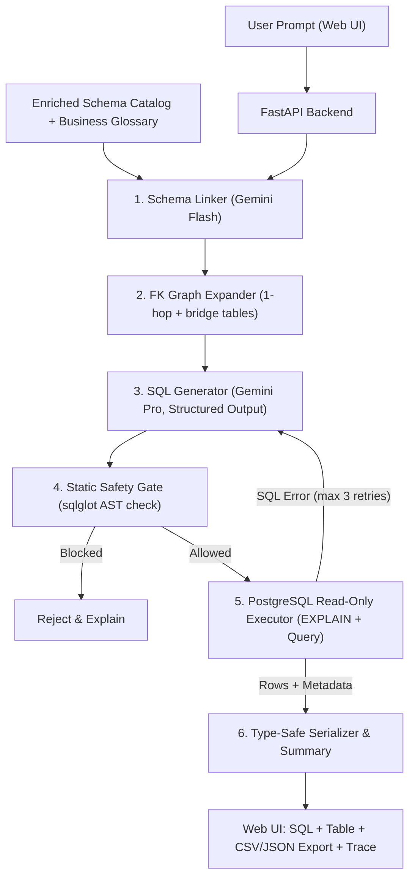

# Architecture Plan: PostgreSQL Text-to-SQL App (Python + Gemini)

This plan outlines a production-minded Text-to-SQL system tailored for a **complex 50-table PostgreSQL database** with diverse data types (`JSONB`, arrays, enums, `timestamptz`, `UUID`, `NUMERIC`, ranges, etc.), powered by **Google Gemini**, a **Python (FastAPI)** backend, and a **web UI**.

---

## 1. High-Level Architecture

With 50 tables and varied column types, sending the entire raw schema on every prompt leads to token bloat, missed joins, and type-casting errors. Instead, the system separates **offline schema enrichment** from a **multi-step query pipeline**:



---

## 2. Solving the Two Hard Problems

### A. Navigating 50 Tables Accurately (Schema Linking + FK Expansion)
1. **Rich Introspection (`pg_catalog` + `information_schema`)**:
   - Pulls tables, views, columns, PostgreSQL types, primary keys, foreign keys, check constraints, and `COMMENT ON TABLE/COLUMN` annotations.
   - Builds a **Foreign Key Graph** so relationships between tables are explicit.
2. **Two-Stage Selection**:
   - **Stage 1 (Compact Index):** All 50 tables fit cleanly in ~2,000–3,000 tokens as 1-line summaries (`table_name: description | key columns`). A fast Gemini call (`gemini-2.5-flash`) selects the relevant candidate tables (typically 3–10) for the user's question.
   - **Stage 2 (Graph Expansion):** Automatically includes bridge/junction tables and shortest FK paths connecting the selected tables so multi-hop joins don't hallucinate join keys.
   - **Focused Context:** Only the selected tables' full DDL, constraints, enum labels, JSONB schemas, and sample values are passed to the SQL generation model.
3. **Optional Semantic Layer (`glossary.yaml`)**:
   - Lets you define business terms (e.g., `"active customer" = status = 'active' AND deleted_at IS NULL`), column overrides, and verified **few-shot SQL examples** that are retrieved when relevant.

### B. Handling Complex PostgreSQL Data Types
During schema profiling (run once and refreshed on demand), the profiler inspects real data safely (`TABLESAMPLE` / `LIMIT 500`) to capture what raw DDL hides:

| PostgreSQL Type | Profiling Strategy | Prompt & Execution Handling |
| :--- | :--- | :--- |
| **`ENUM` (`pg_enum`)** | Extract exact enum labels from `pg_enum` | Inject exact allowed values so Gemini never invents casing |
| **`JSONB` / `JSON`** | Sample rows and recursively infer key paths + value types (e.g. `meta->>'tier' (text)`) | Provide inferred JSON structure; guide `->>`, `@>`, `jsonb_array_elements` usage |
| **Arrays (`text[]`, `int[]`)** | Detect base element type + sample elements | Guide `ANY(...)`, `@>`, `unnest(...)` |
| **Low-cardinality text** | If distinct values $\le 25$, cache top distinct strings | Prevents empty results from guessed status/category strings |
| **`timestamptz` / `date` / `interval`** | Capture DB timezone (`SHOW TIMEZONE`) | Pass current timestamp + timezone; prefer index-friendly range filters |
| **`NUMERIC`, `UUID`, `inet`, `daterange`, `bytea`** | Record exact type + precision | Custom Python serializer cleanly formats values for JSON/table rendering |

---

## 3. Safety, Reliability & Self-Correction

> [!IMPORTANT]
> Never rely on prompt instructions alone to prevent destructive queries. Safety is enforced in **three independent layers**.

1. **Database-Level Isolation**:
   - Connect with a dedicated **read-only PostgreSQL role** (`SELECT` privilege only).
   - Every query runs inside `SET TRANSACTION READ ONLY` with `SET LOCAL statement_timeout = '10000'` (10s default, configurable).
2. **AST Validation (`sqlglot`, dialect `postgres`)**:
   - Rejects multi-statement queries and anything other than a single `SELECT` / `WITH ... SELECT`.
   - Denylists hazardous functions (`pg_read_file`, `pg_ls_dir`, `pg_sleep`, `dblink`, `lo_import`, etc.).
   - Automatically injects a `LIMIT` (default `200`, max `1000`) if omitted so a prompt cannot return millions of rows.
3. **Dry-Run + Auto-Repair Loop**:
   - Runs `EXPLAIN (FORMAT JSON)` before executing to catch syntax/type errors immediately.
   - If PostgreSQL returns an error (e.g., type mismatch on `JSONB` cast or missing `GROUP BY`), the error message and query are fed back to Gemini for up to **3 self-correction attempts**.
   - If a prompt is genuinely ambiguous, Gemini can return a **clarifying question** instead of guessing silently.

---

## 4. Proposed Project Structure

```text
pg-nl2sql/
├── pyproject.toml              # Python 3.11+, uv/pip dependencies
├── .env.example                # DATABASE_URL, GEMINI_API_KEY, limits
├── glossary.yaml               # Optional business definitions & few-shot examples
├── docker-compose.yml          # Optional local Postgres 16 for testing
├── scripts/
│   └── seed_demo_db.sql        # Realistic multi-type Postgres demo schema
├── app/
│   ├── main.py                 # FastAPI app, REST endpoints, serves web UI
│   ├── config.py               # Pydantic settings (timeouts, row limits, models)
│   ├── db/
│   │   ├── connection.py       # psycopg3 connection pool + read-only transaction helper
│   │   ├── introspector.py     # pg_catalog + JSONB/enum/distinct-value profiler
│   │   └── serializer.py       # Safe JSON formatting for Postgres types
│   ├── nl2sql/
│   │   ├── catalog.py          # Cached schema catalog + FK graph + glossary loader
│   │   ├── linker.py           # Stage 1: table selection + FK bridge expansion
│   │   ├── generator.py        # Stage 2: Gemini structured SQL generation + repair
│   │   ├── validator.py        # sqlglot AST safety gate + LIMIT enforcement
│   │   └── pipeline.py         # End-to-end orchestrator + execution trace
│   └── static/                 # Zero-build clean Web UI (HTML/CSS/JS)
│       ├── index.html
│       ├── styles.css
│       └── app.js
└── tests/
    ├── test_validator.py       # SQL injection / DDL / DML / limit enforcement tests
    ├── test_linker.py          # FK graph expansion & catalog pruning tests
    └── test_serializer.py      # Complex Postgres type serialization tests
```

---

## 5. Key API Endpoints & Web UI Features

### Backend API
- `POST /api/query` — Accepts `{ prompt, history[], max_rows }`, returns `{ sql, explanation, assumptions, columns, rows, row_count, truncated, execution_ms, trace }`.
- `POST /api/execute` — Re-runs user-edited SQL through the same `sqlglot` safety gate and read-only executor.
- `GET /api/schema` — Returns the introspected catalog (tables, columns, types, enums, inferred JSONB paths, FK links).
- `POST /api/schema/refresh` — Re-runs database introspection and profiling.

### Web UI
- **Prompt & Follow-up Chat:** Ask questions and refine them ("now filter to last 90 days", "break that down by region").
- **SQL Panel:** Syntax-highlighted PostgreSQL query, copy button, and direct edit + re-run capability.
- **Results Grid:** Clean tabular display with formatted pills for `JSONB`, arrays, `NULL`, timestamps, sorting, and one-click **CSV / JSON export**.
- **Pipeline Trace Drawer:** Shows which tables were linked, any assumptions made, and any auto-repair retries.
- **Schema Explorer Sidebar:** Searchable tree of your 50 tables, column types, enum values, and JSONB keys.

---

## 6. Model Configuration (Gemini)

Using the official `google-genai` Python SDK:
- **Schema Linking (Stage 1):** `gemini-2.5-flash` (fast, cheap, high recall over 50 table summaries).
- **SQL Generation & Repair (Stage 2):** `gemini-2.5-pro` (stronger reasoning for complex multi-table joins, CTEs, window functions, and `JSONB`/array syntax) — configurable via `.env` so you can switch to `gemini-2.5-flash` for lower latency/cost.

---

## 7. Verification Plan

1. **Unit Tests (Offline):**
   - `sqlglot` validator blocks `DROP`, `DELETE`, `INSERT`, `UPDATE`, stacked queries, CTE data-modifying statements (`WITH d AS (DELETE ...) SELECT ...`), and dangerous Postgres functions.
   - Automatic `LIMIT` injection preserves existing smaller limits and caps excessive ones.
   - FK graph expansion discovers intermediate junction tables accurately.
   - Serializer handles `Decimal`, `UUID`, `datetime`, `timedelta`, `JSONB`, arrays, `IPv4Address`, `bytes`, and range types cleanly.
2. **End-to-End Verification:**
   - Validate schema catalog loading, API endpoints, and UI rendering locally.
   - Provide a ready-to-run `docker-compose.yml` + complex multi-type seed database so you can test immediately or point `DATABASE_URL` straight at your 50-table PostgreSQL database.
